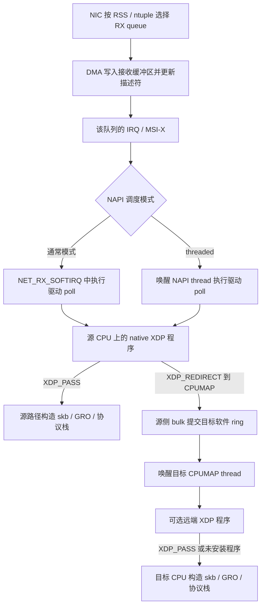

# CPUMAP 保序、历史缺口、threaded NAPI 与多队列执行路径

日期：2026-09-23。补充 `programmable-rx-community-research-20260923.md`。
范围：只调研和解释；未实现新功能，未修改现有 v3 补丁，未启动测试或 VM。

## 证据和版本范围

本地核对注册工作区 `/home/sisyphus/code/worktree/rfs_bpf`，固定基线
`45c13f3f9e3bb15fd89ff2864c6f627a3b4b4229`（2026-08-25）。
`develop rfs_bpf index` 确认索引对应 HEAD；最新项目修改仍须读取工作区。
本文没有把项目新增 hook 当成上游能力。另核对官方文档、torvalds/linux
公开文件、原始邮件及演讲；在线 master 和文档会变化，引用不等于发行版标签。
引入版本用本地 `git describe --contains` 和提交历史核对。

主要历史材料是 Jesper Dangaard Brouer 的 NetConf 2017 Seoul 演讲第 11、
24–31 页，以及 Lorenzo Bianconi 的 Red Hat 2021-05-13 文章。
一些归档页面直接打开失败，相应历史讨论通过搜索索引中的原始邮件段落
交叉核对；没有把搜索抓取日期当成邮件发布日期。未复现外部性能数字。

## 1. RPS、RFS 和 CPUMAP 的保序边界

三者都受益于避免主机自己引入流内乱序，但保证来自不同机制。

- 普通 RPS 通过稳定 hash→CPU 映射把同流送到同一 backlog；不能把 RFS 的
  `last_qtail` 检查说成所有 RPS 都执行。修改 `rps_cpus` 等配置也不能一律
  宣称具有在线迁移保序保证。
- RFS 让目标 CPU 跟随应用活动变化。`get_rps_cpu()` 比较期望 CPU 与实际
  CPU，在旧 CPU 的 `input_queue_head` 达到该 flow slot 的 `last_qtail` 后
  才正常切换，防止新 CPU 的新包越过旧 CPU 上的旧包。
- 这个完成边界是 backlog 的处理进度，不是等应用 `recv()` 消费，也不是
  网络中任意设备、所有后续异步路径都绝不乱序。原生代码还保留旧 CPU
  未设置或已离线的切换例外。
- CPUMAP 是可编程的帧投递机制，没有默认的应用跟随策略及流级迁移协议。
  同一流以稳定顺序从同一源 RX 路径进入同一个、不被替换的 CPUMAP entry，
  不会仅因为使用 CPUMAP 就必然乱序。逐包轮询、动态换核、多个源队列并发
  输入同流、替换 entry 等则不能依靠目标 FIFO 自动建立全局顺序。

例：P1 在 CPU A 的队列中等待，此时策略改为 CPU B；P2 在空闲 CPU B
立即进入协议栈，就可能先于 P1。TCP 可以重排，但有额外处理和潜在误重传
成本；UDP 应用可能需要自己处理乱序。问题不是 CPUMAP 的用户不需要保序，
而是它没有强制所有策略承担流级状态及跨 CPU 完成同步成本。

历史上 CPUMAP 从独立 XDP 投递机制起步，并非先复制完整 RFS 再删除保序。
2017 年作者已经讨论过给 BPF 提供在途信息和可选迁移能力。

源码核对：`net/core/dev.c:get_rps_cpu()` 的 RFS 分支与 `try_rps` 分支；
`kernel/bpf/cpumap.c` 的 per-CPU bulk、MPSC ptr_ring、单消费者及 entry 更新。
参考：[RPS/RFS 官方说明](https://docs.kernel.org/networking/scaling.html)、
[2017 年在途状态讨论](https://lists.openwall.net/netdev/2017/10/06/96)。

## 2. 原始 missing/crazy 想法与当前状态

| 当时的问题或设想 | 核对结果 |
| --- | --- |
| XDP_REDIRECT 的驱动发送接口只能逐包，缺少通用内存归还机制 | 2018 年已有批量 `ndo_xdp_xmit()`、`xdp_return_frame()`；不能继续当作现有普遍缺口 |
| CPUMAP 私有 `xdp_pkt` 应推广为通用包表示 | 2018 年通用 `xdp_frame` 已实现并用于 CPUMAP |
| generic XDP 无法重定向至 CPUMAP，以及缺少批处理 | CPUMAP generic 支持从 5.15 起存在；源侧 `cpu_map_generic_redirect()` 仍逐 skb 入队/唤醒，不等同 native 的 bulk，且 skb 已在源侧创建 |
| 目标 CPU 上再运行 BPF | 5.9 起可给 CPUMAP entry 安装 `BPF_XDP_CPUMAP` 程序；不是当年所有入队、丢弃、完成回调都已实现 |
| GRO 缺失 | 6.15 已合入，目标线程使用独立 `gro_node`；不能再依据 2021 年文章判定没有 GRO |
| jumbo/multi-buffer | 5.18 起具备 XDP frags 基础支持和 CPUMAP selftests；实际 MTU、网卡及挂载程序仍须支持 frags |
| 读取硬件 RX hash、checksum，并在远端构造 skb 时恢复 | 部分完成：驱动可实现 timestamp/hash/VLAN 的 metadata kfunc；native 重定向构造 skb 仍未自动恢复硬件 checksum、hash 和原 RX queue |
| 8 包 × 8 bucket，按 hash 局部聚类；高优先级 bucket 立即入队 | 当前 CPUMAP 没有这套通用 bucket/priority ABI；仍为每源 CPU、每目标 entry 的小 bulk + ptr_ring。已有普通 GRO 不代表该设想实现 |
| enqueue/drop/dequeue 协作，维护每流在途数，支持有序动态换核 | 远端程序和统计提供部分组件；未在所核对的上游接口与代码发现完整的 RFS 式迁移协议 |
| 利用即将丢弃的包再次选路，或向 app/socket 优先发送拥塞信息 | 当前标准 CPUMAP 满队列路径丢弃并统计，没有对应的通用逐包 BPF 重选或 socket 通知回调 |

原始条目来源：[2017 演讲](https://people.netfilter.org/hawk/presentations/NetConf2017_Seoul/XDP_devel_update_NetConf2017_Seoul.pdf)、
[2021 Red Hat 文章](https://developers.redhat.com/blog/2021/05/13/receive-side-scaling-rss-with-ebpf-and-cpumap)。
现状另以源码、提交与文档确认，未直接沿用历史 TODO 状态。

已合并证据（首次版本指主线，不排除发行版回移）：

- `735fc4054b3a25034445c6713d259da0f96f8131`：2018 年批量 `ndo_xdp_xmit`。
- `5ab073ffd326480a6185d096e9703f62ef92b86c`：2018 年 `xdp_return_frame`。
- `c0048cff8abb69c956ce1277d17a3f7a14e41522` 和 `70280ed91cb8`：通用 frame/CPUMAP 转换。
- `9216477449f3`：远端 XDP 程序；5.9 也见 [CPUMAP 文档](https://docs.kernel.org/bpf/map_cpumap.html)。
- `11941f8a8536`：generic CPUMAP；`git describe --contains` 指向 `v5.15-rc1`。
- `0c5e118cb4b8`：CPUMAP/DEVMAP frags selftests；对应 `v5.18-rc1`。
  `ab0db46396ca` 的早期 frags redirect 限制明确豁免 CPUMAP。
- [`4f8ab26a034f04f918c8d36c051ec84e4082eed5`](https://github.com/torvalds/linux/commit/4f8ab26a034f04f918c8d36c051ec84e4082eed5)：
  2025-02 合入 GRO；对应 `v6.15-rc1`。

尚未完整解决的方向有以下公开探索：

1. **元数据传递和写回。** 2022 年 Generic Hints 大系列探索通用表示；之后
   已有 driver metadata kfunc。2025 年 Jesper/Lorenzo 的七补丁系列又提出把
   hash/VLAN/timestamp 写入 frame，再用于构造 skb，以处理软件计算的隧道内层
   hash。讨论涉及固定 frame 字段、可扩展表示，以及将 set 延迟到 skb 转换点。
   当前本地基线和公开 `__xdp_build_skb_from_frame()` 均未提供该完整写回链，
   不能把 2025 年 RFC/patch series 当成已合并。
   [2022 探索](https://lists.xdp-project.net/xdp-hints/7a91042b-4406-4b99-99c5-6ec1ec7b98d7%40intel.com/t/)、
   [2025 方案和反馈](https://lists.openwall.net/netdev/2025/07/07/153)、
   [转换点 set 讨论](https://www.spinics.net/lists/bpf/msg151053.html)、
   [当前文档](https://docs.kernel.org/networking/xdp-rx-metadata.html)。
2. **在线迁移保序。** 2017 年提出用协作 BPF 程序计数，后来也列入
   [CPUMAP 项目计划](https://xdp-project.net/areas/cpumap.html)。这些材料证明
   存在明确探索，不证明已有完整实现。当前目标 XDP 和 kthread tracepoint
   都位于 GRO/协议栈之前：推论是，出队或目标 BPF 递增计数器不能直接作为
   RFS 式完成信号，旧包仍可能被 GRO 持有，还需解决失败记账和并发切换。
3. **优先级与可编程排队。** Toke 的 2022 年 XDP packet queueing/scheduling
   RFC 实验了 PIFO map 和 dequeue 程序，是相关但不同的方向，主要针对
   XDP 转发/发送排队，不等于 CPUMAP 已支持原演讲中的优先级入队或迁移保序。
   所核对基线没有该 PIFO map UAPI。
   [原始 RFC](https://lists.openwall.net/netdev/2022/07/13/138)。
4. **丢包反馈。** 当前 tracepoint 可用于观测及后续调节策略；未找到原演讲中
   满队列包重新提交/向 socket 优先发拥塞通知的通用上游实现。
   `bpf_redirect_map()` 的 flags fallback 适用于 map lookup 失败，不能处理
   返回 XDP_REDIRECT 之后、异步 bulk flush 时发生的 ring 满丢弃。

当前代码：`kernel/bpf/cpumap.c:bq_flush_to_queue()/cpu_map_generic_redirect()`；
`net/core/xdp.c:__xdp_build_skb_from_frame()`；`include/uapi/linux/bpf.h`。

## 3. Threaded NAPI 和 CPUMAP 的关系及设计讨论

| 执行单元 | 责任 | 生命周期/调度对象 |
| --- | --- | --- |
| 网卡 NAPI thread | 调用驱动 poll，收割硬件 RX ring，运行源 XDP，处理未重定向包 | 每个启用 threaded 模式的 NAPI；`napi/<ifname>-<id>` |
| CPUMAP thread | 消费目标 entry 的软件 ring，运行可选远端 XDP，构造 skb，GRO/进入协议栈 | 每个 map 中配置的目标 CPU entry；`cpumap/<cpu>/map:<id>` |

二者可以串联。threaded NAPI 改变源 poll 的执行上下文；CPUMAP 不因此把
目标工作并入网卡 NAPI，也不自动联合调整 NAPI affinity、RSS 或应用亲和性。
CPUMAP 线程仍绑在该 entry 指定 CPU，两个不同 CPUMAP 指向同一 CPU 还可能
产生两个工作线程。因此设置线程 CPU、RSS 源队列及目标 CPU 是不同控制点。

直接相关的历史探索：

- Lorenzo 的 PoC 比较过 gro_cells、threaded NAPI 接法；Alexander 倾向拆出
  GRO 状态，避免为了 GRO 引入整套 NAPI。
  [2024 年讨论，包含两个原型链接](https://lists.xdp-project.net/xdp-hints/e0616dcc-1007-4faf-8825-6bf536799cbf%40intel.com/)。
- 2024-08/09 的 GRO 系列确实提出将 CPUMAP custom kthread 改为 CPU-pinned
  threaded NAPI。Jakub 指出用 fake netdev 仅取得线程抽象并不合适，建议
  考虑 backlog 或拆出所需功能；CPUMAP 需要的是 per-CPU cache 和 GRO，
  没有对应硬件 IRQ 要管理。
  [回复，含 Jakub 原文](https://lists.openwall.net/netdev/2024/09/03/409)。
- 最终 2025 年 GRO 补丁保留 CPUMAP kthread，复用独立 GRO 和 skb cache。
  2025-07 的 `71c52411c51bf4f0869c572294ce8123b26528d5` 又抽出
  `gro_flush_normal()` 供 NAPI 与 CPUMAP 共用。共享组件不等于统一调度。

当前 NAPI 还支持按实例设置 threaded busy-poll。它可以改变源端的 IRQ/poll
节奏，但 CPUMAP 消费者仍执行自己的软件 ring 循环，不会自动 busy-poll
网卡。不能把 NAPI thread、IRQ thread、ksoftirqd 和 CPUMAP thread 混为一谈。
[官方文档](https://docs.kernel.org/networking/napi.html)。

对项目的推论：可在策略管理层协调源 NAPI/RSS、CPUMAP worker、应用线程的
CPU/LLC 分配，但没有证据表明两套线程叠加必然提速。它增加软件排队、唤醒
和跨核缓存传递；若 RSS+NAPI 已满足目标，额外 CPUMAP 可能没有收益。若需要
超出硬件能力的流分类或把早期收包与协议栈隔离，则 CPUMAP 的独立阶段有价值。
本轮没有跑实网性能对照，不能量化收益或代价。

## 4. Hook、多队列和中断路径

在常规 IRQ 驱动的 native XDP 路径中：

图中的 XDP_PASS 分支进入栈后仍可能有已配置的 RPS 等进一步分发。
真正的源 hook 是驱动中的 XDP 调用，CPUMAP 是 redirect backend；目标 entry
另有可选 XDP hook。重定向不会让包回到目标 CPU 对应的网卡硬件 RX ring。
CPUMAP 也没有替该包重新触发一次 NIC RX 中断。

多队列常规模型是按 netdev 挂一个 XDP 程序，由各队列的 NAPI 上下文并发
执行同一程序，并非全部进入一个 BPF 线程。`ixgbe_xdp_setup()` 把 adapter
程序指针发布到每个 RX ring，`ixgbe_run_xdp()` 从当前 ring 读取并运行程序。
NAPI/IRQ/RX queue 不一定严格一对一，要看驱动；ixgbe 一个 vector 的 poll
就可以处理多个 ring。

源程序可使用 `ctx->rx_queue_index`、CPU、包头、共享 map 来选择策略；需要
不同代码时可在源程序分支、tail call 或用 dispatcher。通常不要求每个硬件
队列分别 attach 不同 XDP 程序。目标 CPUMAP entry 的远端程序可以相同或
不同，它按目标 entry 配置，不能和源 RX queue 的挂载方式混淆。

特别注意当前 CPUMAP native 远端程序的 rxq 是临时构造，代码仍有透传原
`queue_index` 的 TODO；需要源 RX queue 的策略应在源 XDP 读取，或主动用
自定义 metadata 传递，不能认为远端 `rx_queue_index` 保留原值。

中断方面：硬件仍按 RSS/ntuple、IRQ affinity 和中断合并配置收包；启用
CPUMAP 不把这部分搬到目标 CPU。普通 NAPI 仍从 NET_RX softirq poll，threaded
NAPI 则唤醒 poll 线程。目标 CPUMAP 通过 `wake_up_process()` 驱动 kthread，
在 BH-disabled 区间调用 GRO/接收栈，与 RPS 的远端 backlog 调度不同。
RPS 的 IPI 也会批量发送，不能用“RPS 每包 IPI、CPUMAP 没有 IPI”来比较。
调度唤醒仍可能引起跨 CPU IPI，`local_bh_enable()` 也可能运行待处理 softirq，
所以不能声称 CPUMAP 完全没有 IPI/softirq。

有两个执行模式边界：busy polling 可在本轮硬件中断到来前主动 poll；generic
XDP 则在 skb 已创建后运行。硬件 offloaded XDP 是另一种模式，不能把通常的
host CPUMAP 解释成网卡中断前的硬件选核机制。

源码：`drivers/net/ethernet/intel/ixgbe/ixgbe_main.c` 的 IRQ/poll/XDP/setup；
`net/core/dev.c:____napi_schedule()/napi_threaded_poll_loop()`；
`kernel/bpf/cpumap.c:__cpu_map_flush()/cpu_map_kthread_run()`。
补充公开来源：[CPUMAP 文档](https://docs.kernel.org/bpf/map_cpumap.html)、
[NAPI 文档](https://docs.kernel.org/networking/napi.html)、
[CPUMAP 当前代码](https://github.com/torvalds/linux/blob/master/kernel/bpf/cpumap.c)。

## 项目决策状态

本轮进一步支持把“策略、观测、投递、可选迁移契约”分开研究。对 CPUMAP
的扩展应针对已核实缺口，不应重新实现已存在的 GRO、远端 XDP 或线程机制。
是否采用 CPUMAP 后端、增加元数据/完成接口、协调线程部署，仍待具体原型
和性能数据决定；本轮没有据讨论启动实现。G1–G5 健壮性任务继续维持已加入
TODO、暂不实施的状态。
